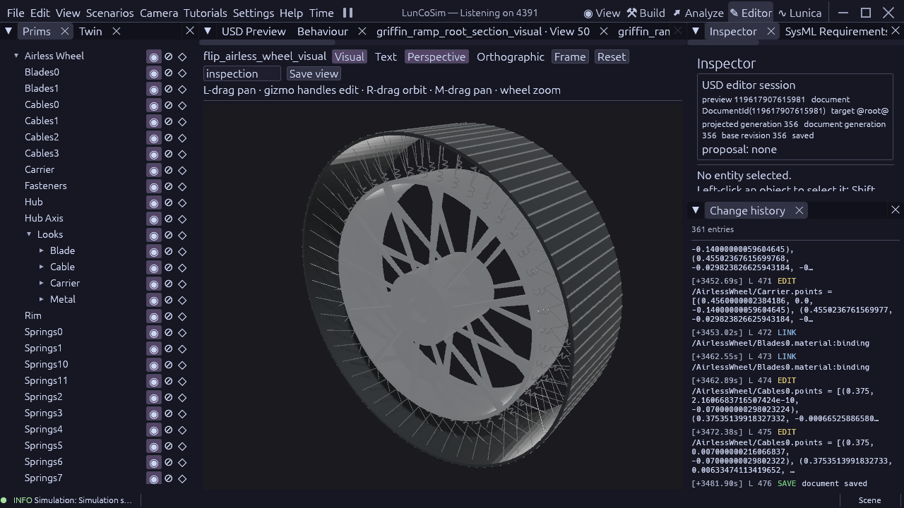

# FLIP airless wheel reconstruction

The wheel appearance follows Venturi's open, cable-supported construction rather
than a pneumatic tire silhouette. The detached component uses SI metres, Y-up,
a Z axle and a centred `HubAxis` datum. The existing wheel retains collision,
mass/inertia, drivetrain and suspension ownership; this asset adds rendering only.

[Venturi's 19 June 2023 release](https://venturi.space/en/article/world-premiere-venturi-hyper-deformable-lunar-wheel/)
publishes a 930 mm diameter and 192 cables. Its [2023 media kit, page 3](https://www.venturi.com/wp-content/uploads/2023/06/Media_Kit_Venturi_Wheel.pdf)
shows four cable rows, springs around the rim, and stainless-steel tread blades
held by a proprietary elastic material. [Astrolab](https://www.astrolab.space/flip-rover/)
identifies FLIP's full-size FLEX wheels. These sources support the architecture;
they are not an as-built FLIP drawing or a current supplier ICD.

The retained 280 mm width, hub/rim sizes, cable diameter, web/window shape,
96-spring packaging, 96-blade count and all mounting locations remain explicit
reconstruction estimates. The component is an undeformed rigid presentation.
It does not qualify tire load-deflection, footprint, fatigue, strength, thermal
properties or lateral response. The current contact model remains an approximation.

`FlipAirlessWheelRequirements` owns dimensions, counts, drawing budgets and
presentation profiles. Stainless steel is known only as a tread-blade material
family; its grade, condition and gauge are unreleased. Cable/rim alloy and the
elastic material's composition are also unreleased. Typed material selections
retain those gaps. The four reusable PBR profiles convey optical appearance
without inventing engineering properties or qualified reflectance data.

Acceptance requires source-owned envelope/count/topology observations, centred
axle and render-only roles, four explicit material networks, the drawing budget,
a malformed-geometry negative and an inspected production Editor view. Installed
wheel acceptance additionally requires one centred `purpose=render` root, a hidden
analytic proxy, unchanged mechanical fields and measured roll in production.
The scene's 60 FPS target remains a separate runtime gate.

The saved component passes **62 production checks**. Native f64 observations
measure 24 meshes, 23,328 triangles, 192 disconnected closed cable solids,
96 closed spring solids and 96 closed tread blades. Every mesh is closed with
consistent edge orientation and positive signed volume. The maximum vertex
radius excess is 15.3 nm and width error 1.2 nm, within the existing 2 micrometre
serialization allowance. These figures describe the represented mesh against
its reconstruction parameters, not flight metrology or manufacturing accuracy.
The observer identifies actual cable cap poles and spring terminal faces from
their measured topology. All 192 inner seats close within 16.7 nm, with two
cables per spring. Outer cap centres embed at least 0.7999 mm inside conservative
bounds of the actual carrier annulus. The early prototype's 7 mm spring-seat
offset and 1 mm outboard gap are corrected through source-owned relationships.
Neither connection is a qualified fastening or structural load-path model.

An oversized-carrier fixture fails exactly the geometry constraint, while a
temporary wrong blade-material binding fails exactly its surface-role check.
A complete cable shifted by 7 mm retains its envelope/topology but fails the
connection constraint. The outboard-gap baseline also fails before correction.
Undo restores the temporary negatives and all 62 checks pass again. Fresh headless
production processes independently run the positive and oversized fixtures,
with exit codes 0 and 1 respectively. Their exact commands and typed results
are in the [receipt](evidence/flip-airless-wheel-2026-10-23.json).
Both processes use standard 60 Hz simulation and eight physics substeps;
this render-only test contains no loaded vehicle and measures no FPS.

The component and positive fixture pass mounted USD preflight without findings.
The complete 29-file SysML source set validates without errors, retaining the
existing 153 warnings. The provenance audit covers 229 requirement targets and
229 evidence records. Its typed source/evidence scans now use the declared part
identities without requiring naming prefixes; the evidence-prefix filter had
incorrectly excluded the already authored root-bearing record.

Authoring uses the existing document boundary throughout. `creation_plan`
returns a bounded mesh header; `geometry(group)` supplies native f64 points,
face counts and indices, queried separately. The external HTTP adapter formats
those arrays for the existing `SetAttribute` USD-literal fields and submits
the header and geometry together through `ApplyUsdOps`. The `point3f[]` field
is the explicit USD rendering/schema precision boundary. No geometry math is
duplicated in the adapter. Existing material planning supplies the four source
profiles. Save and readback remain owned by the USD document tools.

Open `components/rover/flip_airless_wheel_visual.usda` for the detached review,
or run the `FlipAirlessWheelRequirements::Verify_FLIPAirlessWheel` case with
`--max-ticks 1200`. The deliberate negative is
`tests/flip_airless_wheel_oversize.usda`; launch it directly with its scene and
verdict channel, since the verification selector maps the positive scene.

The production rover still uses its cylinder/shader appearance. Installing the
new component on all four wheels, replacing the stale single-cylinder visual
requirement, and checking native render-root binding/roll are the next assembly
step. The component qualifies no ramp path, load-deflection or full-mission
performance. The optimization-owned physics findings remain separate.
