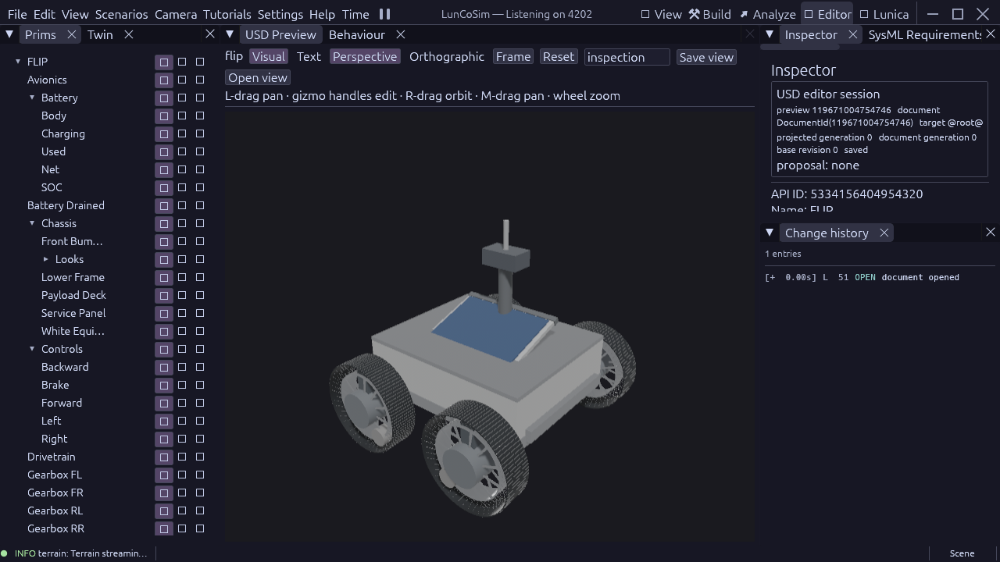

# FLIP runtime update — 23 October 2026

The current upstream `vehicles/flip.usda` is the working rover. Its installed
airless-wheel render component, finite EPS, thermal network, native drivetrain
and operator route remain together. The local v5 CAD alternative is retained;
it is not the active Griffin vehicle.

Two application projection fixes close the observed runtime gaps:

- USD projection admits all currently eligible queued work, including prims
  that became eligible after asynchronous mesh preparation. An Added-only
  queue could miss that transition and hold physics indefinitely. The original
  FLIP route baseline stopped at tick 450 with deferred-prim and binding holds;
  the corrected build completes the same unchanged route observer.
- Hidden primitive proxies retain their authored parent frame. There is no
  primitive render mesh to orient, and applying its basis to the parent also
  rotated the referenced airless-wheel details in the Editor. Visible primitive
  mesh behavior and physical wheel parameters are unchanged.

## Accepted evidence

Simulator HEAD `a23ab8ec8`, model HEAD `daf2306`, with retained local changes.
Native Avian remains the published `9097ce92e5d236c747a68567368575014c28fff5` pin.
The production graphical executable was rebuilt with the normal optimized dev
profile, repository target, sccache and four jobs.

| Gate | Result |
| --- | --- |
| Existing FLIP operator route | PASS, tick 1195 / 19.92 simulated s; three points, upright driving, HUD start/stop, manual takeover and thermal/brake paths |
| Existing airless-wheel assembly requirements | PASS, 129 checks |
| Native W/S/A/D/Space input | PASS, ten press/release samples, 110 assertions |
| New fixed-tick motion fixture | PASS, tick 845 / 14.08 simulated s; 28 motion/roll/stop assertions plus completion gate |
| Editor appearance | Inspected production screenshot: wheels upright, centred and separated from hidden proxies |

Forward signed travel was 5.34 m; reverse travel was 4.82 m. Forward braking
reduced speed from 3.370 to 0.0344 m/s; reverse braking reduced speed from 3.061
to 0.000602 m/s. Each of the four render roots matched its measured axle roll
in both directions (absolute quaternion dot approximately 1). The motion test
uses the wheel's authored heading/axle frame, rather than the generic scene
forward axis.



The motion fixture reuses the existing route scene and overrides only the test
observer. It was created and saved through typed document operations. Run:

```powershell
$env:LUNCO_ASSET_ROOT='F:/lunco-sim/assets'
F:/lunco-sim/target/debug/luncosim.exe test --scene F:/lunar-base-model/twins/astrobotic-griffin-1/tests/flip_motion.usda --verdict-channel FLIP_MOTION_COMPLETE --max-ticks 1800 --api 4201
```

Full local receipts, source snapshots and authoring operations are in
`F:/lunar-base-model/runs/flip-update-2026-10-23/`.

## Remaining boundary

This qualifies the standalone FLIP rover and operator route, not a complete
Griffin deployment. The full mission still fails its task with `Length of
string too large`, then exhausts its verdict horizon. A bounded-log experiment
did not resolve it and was reverted; no acceptance threshold was relaxed.
No rendered FPS or long-duration EPS endurance claim is made.