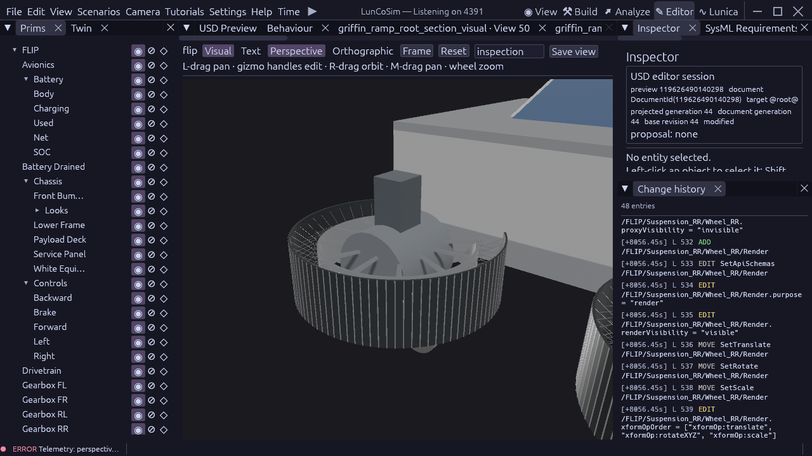

# FLIP wheel installation checkpoint

All four wheels in `vehicles/flip.usda` now reference the qualified detached
airless wheel through a centred `Render` Xform. The existing Cylinder is a
hidden `purpose=proxy` owner; each child has `purpose=render` and explicit
render visibility. Installation used one dry Rhai plan and one native
`ApplyUsdOps` batch per station, followed by projection, readback, a focused
gate and `SaveDocument`. No USD text was written externally.

The production `FlipWheelRequirements::Verify_FLIPWheelRequirements` gate passes
**129 checks**, exit 0, at tick 6 (0.1 s). Each station also passes its 18-check
Editor document gate. A temporary 10 mm FL render-root displacement fails
exactly its translation check; native Undo restores all 18 checks and the
saved source. The other two assembly observers now use this same render-root
contract rather than the retired single-cylinder appearance check.

Before/after native queries preserve every existing wheel attribute except
purpose and the added proxyVisibility opinion, every relationship and the
composed schema set plus VisibilityAPI. The source diff preserves all input
connections. Wheel dimensions, axle, mass/inertia, suspension and drivetrain
settings therefore retain their previous authored values. This is parameter
preservation evidence, not a dynamics qualification.

Reproduce the bounded production gate from the USD engine worktree:

```sh
target/debug/luncosim test --scene /home/rod/Documents/models/lunar-base-model/twins/astrobotic-griffin-1/tests/flip_wheel_requirements.usda --verification FlipWheelRequirements::Verify_FLIPWheelRequirements --verdict-channel FLIP_WHEEL_REQUIREMENTS --max-ticks 1200 --tick-hz 60 --threads 1 --jitter 0 --api 4394
```

The tested binary is revision `0cb4d37137554af3227a316100c903f44a1c3a4c`,
SHA-256 `5b24ec52f8893910cf764334a75279a20522bfdd8d30d0bbfdb827b5ed28c73d`.
The USD checkout is newer; this is not latest-binary acceptance. The compact
[receipt](evidence/flip-wheel-install-2026-10-23.json) records the source revision,
hashes and accepted scope. Full local evidence is under
`usd/.cache/codex-evidence/flip-airless-install-20261023/`.

Installed appearance is **not accepted**. In the Editor the wheels appear
horizontal even though native USD geometry bounds put their axes along Z.
`lunco-usd-bevy/src/lib.rs` applies a primitive's axis basis to the parent
entity Transform, which the referenced mesh descendants inherit. The detached
component remains upright. The source axle and mesh have not been rotated to
compensate for that projection defect.



A preliminary native binding inspection found the render root and hidden
proxy, but that windowed scene had failed scenario imports under an old Twin
mount authority. It supplies no accepted runtime or visual evidence. The
fresh production process above resolves the source and passes the authored
gate; it does not measure roll or render a windowed acceptance view.

Measured native roll, the Editor projection repair, a valid production
windowed review and clean 60 FPS acceptance remain open. Griffin's ramp
payload sweep also needs to include the added visual meshes before any ramp
promotion. The existing fixed-structure ramp result is unchanged. No solver
or dependency change was made. This checkpoint closes the current iteration;
subsequent requested work should focus on Griffin.
