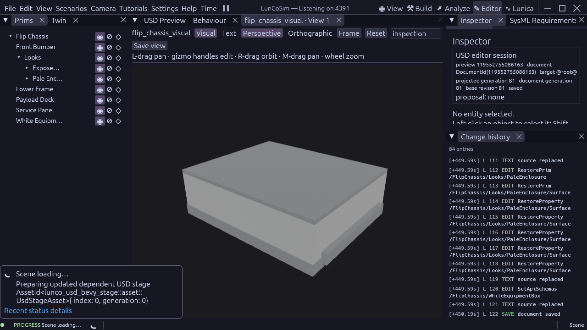
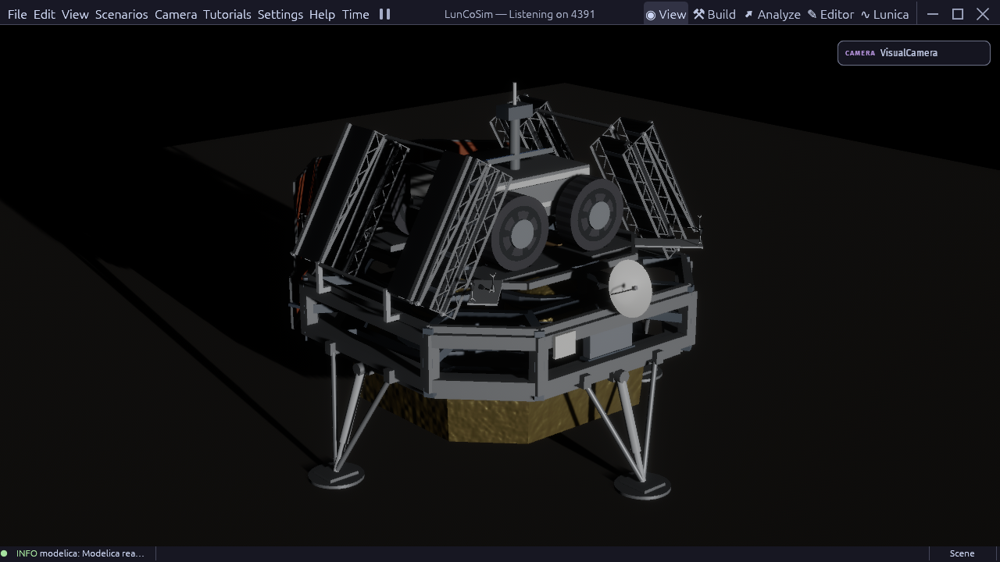

# FLIP chassis finish review

FLIP's five chassis shapes now bind two reusable `UsdPreviewSurface`
materials. The equipment box uses a pale dielectric finish. The lower frame,
bumper, deck and service panel use the shared silver palette already owned by
Griffin's visual configuration. Astrolab's [FLIP page](https://www.astrolab.space/flip-rover/)
and its linked [wheel/chassis rendering](https://www.astrolab.space/wp-content/uploads/2025/06/Picture4.png)
show pale enclosure panels with exposed silver hardware. This is a reference
rendering, not an as-built surface measurement. The source-owned display
parameters remain estimates, separate from engineering material properties.

The existing native material planner produced 27 document operations, applied
through the USD document owner. The final saved component is generation 81
after the Editor journal's before/after review. All five source geometry
records and cooked collision shapes compare exactly with their pre-edit
observations. No mesh, texture, rigid body, mass or contact parameter was added.

Typed SysML member roles and material identities supply the assignment map to
both the planner and verifier. FCC-006 checks the five bindings, both
material/shader identities, explicit
surface connections, and all source-owned color, metallic and roughness
controls. Each profile also executes the normative normalized-input SysML
predicate. `projectionTolerance = 1e-6` covers the declared USD color3f/float
rendering boundary; it is not a manufacturing or physical-optics tolerance.
The chassis fixture explicitly declares metres and Y-up.

The chassis production gate passes all 42 checks at source revision
`15492545019847650768`. The component and integrated visual scene pass mounted
preflight with zero findings. Mounted SysML validates with no errors and the
existing 153 warnings. The provenance catalog covers 221 requirement targets
with 221 evidence records and 69 source elements. These are focused results;
they do not qualify the complete mission.
The [production receipt](evidence/griffin-chassis-finish-2026-10-22.json)
records source hashes, native shape comparisons and the distinct validation
and rendering cohorts.

A diagnostic window in the owned normal production app collected 1,660 raw
frame samples at 1280 × 720, High, standard render profile, with a stable
camera, ready source and zero runtime diagnostics. It averaged 82.63 FPS;
frame time was 11.89 ms p50, 14.66 ms p95 and 16.24 ms p99. The window used the
fixed-pose visual fixture and concurrent simulator workloads were present.
This is contention-affected rendering evidence, not the requested 60 FPS
real-time-physics acceptance. No graphics quality, physics substep, solver or
fixed-timestep setting was reduced.

Remaining visual reconstruction includes FLIP's airless-wheel appearance,
sensor details and deployable-panel geometry. The shared cylinder/contact
model and its rubber-style shader are still an explicit approximation to the
Venturi airless wheels described by Astrolab. Loaded landing, ramp deployment
and full-mission FPS remain separate open gates with optimization owning the
physics repair.

The separate IMU precision repair authored by optimization is integrated in
[USD commit aad1881ba](https://github.com/LunCoSim/lunco-sim/commit/aad1881ba).
The normal USD binary SHA256 is
`0242a65cff83d1adce15b14a67e3f04aa3d69d760aa87f7e1fc19d048675e4e1`.
The original acceleration gate now passes all 267 checks at its unchanged
`1e-9` norm limit; sensor, initialization-policy and scene-transition-generation
gates pass as well. The repair normalizes the validated widened measurement
quaternion and changes no solver or body state. This closes that specific
precision finding; it does not close the loaded landing and ramp gates.
