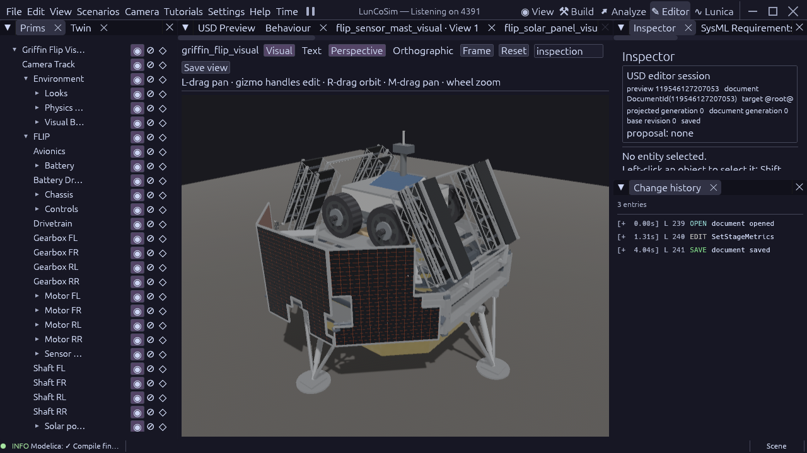

# Griffin interfaces and internal battery packaging

The battery instance had replaced the shared component's transform order with
translation alone. Its unit Cube therefore rendered as a one-metre red block,
protruding through FLIP's equipment roof and obscuring the blue solar panel.
FSP-009 now allocates the case inside the existing equipment enclosure:
1.684 × 0.20 × 1.36 m, centered at rover-local (0, 0.258, 0) m. The allocation
leaves 50 mm horizontal and 98 mm vertical margins. These are explicitly
labelled internal packaging estimates. The public electrical nameplate does
not provide the case dimensions.

The native document owner applied the source-derived Rhai plan as three
transform operations and saved FLIP at document generation 151. The visible
case and cooked collision hull occupy the same internal allocation. The
electrical model, nameplate capacity, and existing 50 kg study mass were
retained. The fixture now explicitly declares SI metres and Y-up; omitted
stage units had made its composed bounds one hundred times too small.
FSP-009's executable allocation predicate checks positive dimensions and
enclosure margins. Its numerical allowance checks authored projection, not
manufacturing accuracy or contact-solver performance.

The wider 4.50 m bus, compact FLIP, 120-degree inward root ramp stow, and
leg/panel alignment remain the geometry described in the
[integrated packaging review](griffin-integrated-packaging-review.md). The
battery fits within an existing chassis enclosure; it adds no exterior
packaging envelope. The focused [FLIP view](evidence/flip-battery-2026-10-22.png)
shows the cleared roof. Both images are production Editor Perspective views
at 1280 × 720, High quality. They are visual evidence, not FPS qualification.

Griffin's environment-to-IMU gravity wires retain double precision. FLIP's
solar outputs and sixteen heat-load inputs retain their source double types.
The heat loads directly instantiate the same canonical
`LunCo.Thermal.HeatLoad` Modelica source and keep their identities and acausal
thermal connections. No continuous equation was duplicated or changed.
The decorative mast, solar proxy and chassis service panel explicitly disable
collision, matching their component requirements.

The required engine interface policy is in
[USD commit eb4ae00eb](https://github.com/LunCoSim/lunco-sim/commit/eb4ae00eb758677b493b44d846ad78a7ecab179e).
It recognizes direction aliases only for declared program members of the
owning components collection and validates their complete source triplets.
Its production test passes all fourteen direction-contract checks, including
crossed-member and mixed-source rejection. Initialization-policy,
scene-transition-generation and standalone sensor gates also pass.

The [production receipt](evidence/griffin-interface-2026-10-22.json) pins
SysML source revision `3062506949441219699`, the binary SHA256 and execution
source hashes. Mounted preflight passes both vehicles and both integrated
scenes with no findings. Four focused production cases pass: integrated
visuals (134 checks), Griffin solar layout, FLIP chassis, and FLIP sensor/power.
The mounted SysML source set validates with zero errors and 153 warnings.
The binary was built normally after fast-forwarding USD to local main
`a45cbca69f22427fb7a7d5f7652940c306efdb28`. The
typed provenance catalog covers 220 requirement targets with 220 evidence
records and 69 source elements. Requirement declarations and provenance links
do not substitute for execution evidence.

Physics ownership remains with optimization. The unchanged acceleration gate
fails 47 of 267 checks, all on rotation-norm invariance, on both the untouched
control and current build; its `1e-9` acceptance was retained. That control, loaded-support drift,
impact and pilot observations are in optimization's physics handoff. Loaded
touchdown, ramp deployment, full-mission acceptance and 60 FPS at High quality
with real-time physics remain open. No solver dependency, timestep, substep,
friction, mass parameter, spring cap or existing physics limit was changed.
