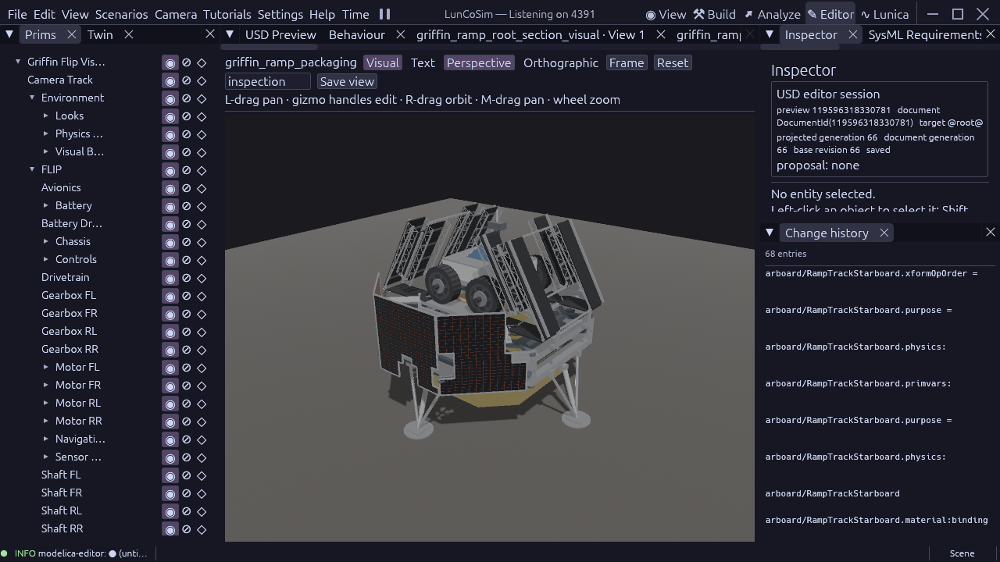

# Raised root hinge and mitered deck entrance

The [previous study](griffin-ramp-packaging-study-2026-10-23.md) confirmed that
the root walking heel crossed its fixed bridge in inward stow. Relieving only
pin pockets left that solid intersection. This reconstruction instead treats
the walking entrance, underside beam ends, raised bearing and fixed bridge as
one interface.

## Geometry and source ownership

`RampRootSection::entryAxisYM` is now one existing lug width, 0.06 m, above
the walking centre plane. This is an explicit reconstruction choice, not an
Astrobotic hinge dimension. The root's nominal deployment angle and walking
thickness define a vertical entrance-face miter through the existing native
mechanical relation. Its lower-corner run is approximately 16.1633 mm. The
underside beams start at that same run; a rectangular beam heel cannot be left
behind the relieved plate. Tongues, shaft, local pins and the named DeckHinge
datum follow the raised axis. The middle/toe axes and section lengths remain
unchanged.

The assembly defines its nominal walking corner at the fixed bridge edge plus
the existing 2 mm interface allowance, with the walking top at the fixed deck
top. Native quaternion/vector composition solves the bearing from that corner,
the nominal section orientation and the root entry datum. The source no longer
carries separate manually maintained candidate bearing X/Y values. Derived
port coordinates are (2.4433441945204004, 2.1596159735495077, 0) m in the lander
frame; starboard is mirrored by the same source-frame relation.

Each bank root is the bearing frame. DeckSection carries the inverse of its
entry datum, and the middle placement composes that offset with the named fold
frames. The fixed bridge remains 1.42 m long, the bus and rover stay unchanged, the
120-degree inward stow is retained, and the nominal walking top remains at the
deck elevation. Fixed bridge plates are 0.576 m wide, leaving the same source
2 mm running clearance beside the moving entrance posts; rotating tracks stay
0.58 m wide. The resulting nominal tire margin on each fixed plate is 0.148 m
per side. This preserves the tire corridor while removing the former zero-gap
guide/bridge edge. These are reconstruction clearances, not flight ICD values.
The 2 mm running seam is not a manufacturing allowance or a
claim that FLIP has traversed it.

## Verification boundary

The revised standalone root passes 127 Editor checks. The production root gate
also passes; the shortened physical-instance fixture exits 1 as required.
These tests check the entrance vertices, beam span/start, raised named datum,
connected fittings, material roles and native metric geometry.

`griffin_ramp_interface_study.rhai` captures native geometry in separate bounded
callbacks, verifies installed member attributes and source-derived placements,
and samples the payload and fixed-bridge paths with explicit document/stage/
source fences. It tests conservative component/member boxes and additionally
uses native cooked vertices, render-mesh vertices and locally fitted member
boxes. Those measurements distinguish a diagonal tongue from the empty corner
of its coarse enclosing box. Every accepted separation remains conservative;
an uncertain envelope cannot be called a physical intersection or accepted as
clear. Between-sample motion allowance remains mandatory.

The Editor study takes explicit document handles and bank coverage. It is a
read-only geometry study, not a headless manifest case or full GVA-001 verdict.
The installed production vehicle still needs promotion of this mechanism,
joint/latch sequencing, mass properties, complete obstacle/ground/mating checks,
loaded traversal and clean 60 FPS acceptance.

## Reference boundary

[NASA's 2021 ramp testing](https://www.nasa.gov/image-article/off-ramps-moon/)
tested wheel containment and several walking-surface materials with a
full-scale Griffin prototype. It supports treating guidance and traction as
interfaces to verify together; it does not provide this hinge ICD.
[Astrobotic's 2026 hardware release](https://www.astrobotic.com/griffin-1-lunar-lander-unveiled-ahead-of-environmental-testing/)
shows the selected lander configuration but says FLIP integration was to follow.
[Astrolab](https://www.astrolab.space/flip-rover/) identifies the shared full-size
FLIP/FLEX tires. These sources do not establish the raised-axis dimension,
entrance miter, running seam or flight mass properties used by this study.

The unrelated stale FLIP camera assembly reference is also corrected through
the Editor: the shared asset's actual FrontCamera is now mounted once beneath
a navigation-frame Xform. That frame uses the existing forward-yaw datum to
map the generic -Z camera convention to this rover's +X travel convention.
It is a viewport camera, not an additional physical navigation sensor.

## Saved qualification — 23 October 2026

The final native Editor sweep passes **22,176 observations**: 11,088 against
payload and 11,088 against all four fixed bridge plates, covering both banks,
all three components and all four deployment phases. Phase interval counts
are 300/180/180/1,184. The minimum conservative payload gap is 50.1168 mm,
including between-sample motion allowance, against the 50 mm study criterion.
The minimum bridge interval bound is positive (2.2326 micrometres); this is a
conservative bound, not the actual hardware running clearance. Independent
readback of the assembled walking vertices measures the four nominal seams at
1.99999984–2.00000055 mm, with walking-height residual below 1 micrometre. These numerical residuals describe
the authored geometry comparison, not a fabrication tolerance.

All 558 referenced members match their component source attributes and child
coverage. Native placement residuals are below 9e-16 m. The saved fixture is
document 119596318330781, generation 66, stage 3, with source revision
10230336678615105864. The study actor was stopped after terminal PASS. The
[receipt](evidence/griffin-raised-root-interface-2026-10-23.json) pins source
hashes, production root qualification, nominal seam observations and final
[aggregate telemetry](evidence/griffin-raised-root-interface-2026-10-23.log).
It does not claim that one telemetry row was persisted per observation.

Root, fixture, FLIP and study-script preflight each report zero errors and
zero warnings. SysML source validation reports zero errors and 153 existing
warnings; this checkpoint does not claim a warning-free requirement catalog.
The root's production result predates the assembly-only bridge-width change;
its selected component, requirement and shared observer/planner inputs are
unchanged. The [camera readback](evidence/griffin-flip-camera-2026-10-23.png)
shows the repaired shared viewport camera in the rover assembly.

This supersedes the candidate bridge obstruction in the previous study. It
leaves the production vehicle, complete GVA-001 acceptance, loaded egress and
performance acceptance open.

## Surrounding structure and opposite-bank follow-up

At the same saved source/generation, the stowed survey covers 476 measured
fixed lander members against all three sections on both banks: 2,856
comparisons. Four overlapping envelopes remain, all at root bearing/pin
connections. Those mating interfaces require a fit check; an envelope overlap
alone is not a physical penetration measurement. There are no remaining
uncertain fixed-bridge envelopes. The antenna reflector and feed-arm NURBS
remain outside this measured coverage.

A separate stowed survey compares all three sections with all 279 measured
members of the opposite bank in both directions: 1,674 comparisons, with no
uncertain envelope pairs and minimum conservative separation of 1.16917 m.
Both follow-ups set the angular interval to zero and qualify only the stowed
pose. They do not accept a moving opposite bank or the full structure sweep.
Their terminal observations are appended to the receipt's log; both temporary
study runs have stopped. The app remains available on the owned port 4391.
