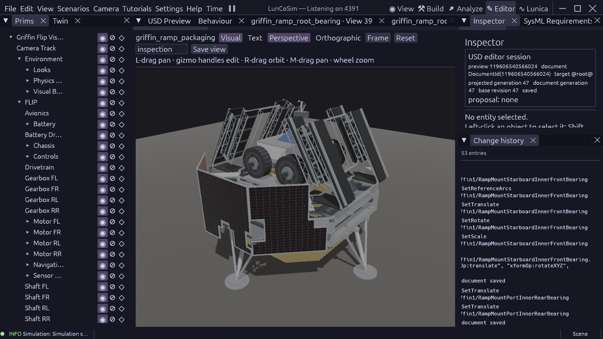

# Ramp clearance against fixed-pose structures

The saved two-bank packaging fixture clears all **480 measured fixed-pose
structure targets** through its source-owned deployment sequence. This extends
the [raised root](griffin-raised-root-interface-2026-10-23.md) and
[bearing](griffin-root-bearing-2026-10-23.md) studies. It does not qualify the
production vehicle, which still contains the earlier mechanism.

The read-only production Rhai study covers both banks, all three sections and
300/180/180/1,184 intervals for root clearance, middle unfolding, opposite-sense
toe unfolding and final lowering. Its 11,088 section/pose observations compare
5,307,456 section/target envelopes. Each sample includes the maximum displacement
to its nearest half-interval endpoint, so the result covers the intervals too.
Uncertain section envelopes are refined against every actual stock member,
including cooked mesh vertices and oriented local stock bounds where available.
The implementation advances a sample cursor and retains one target collection;
it does not raise the interpreter's resource limits.

All 558 installed reference members match their source geometry and poses.
Placement residuals are checked against the existing source geometry tolerance;
a changed placement must stop the study before it can claim source equivalence.
The separately qualified root mating observer supplies the identities of each
bank's two housings and stems. Its 776 comparisons cover any root angle. Only
those four own-bank targets are excluded from the root's filled-box sweep;
middle and toe still check them. Other-bank bearings remain targets throughout.

The minimum interval separation lower bound is **0.000002232599 m**, witnessed
at root-lowering sample 767 against a port fixed walking plate. This is the
remaining bound after subtracting 0.001906009095 m of between-sample motion,
not an actual two-micrometre joint gap. The nominal walking seam is still 2 mm.
This study requires positive separation from structures; the separate 50 mm
payload requirement is unchanged.

Target selection starts with the native composed lander topology. Both candidate
ramp branches are moving geometry and are outside this fixed-target set. Of the
remaining 520 geometry members, 38 are plume effects: their composed material
surface connections resolve to `lunco://shaders/plume.wesl`. The receipt retains
all 38 binding chains. Two members have no native geometry bounds in this binary:
the dish reflector (`NurbsPatch`) and feed arm (`NurbsCurves`). They remain
explicitly unaccepted. The other 480 include visible structure and collision
proxies, so the count is not a count of unique manufactured parts.

A deliberate obstruction uses the actual initial root track as a fixed target
against that same moving track. The unchanged observer rejects its first sample
after refining all 97 root members. A failed conservative-envelope test records
uncertainty; it does not by itself prove solid intersection.

A second negative displaces the installed root section by 5 mm, beyond its
existing 2 mm placement tolerance. The source-equivalence check rejects it
before sweeping. Undo and explicit document save restore the original USD bytes
exactly. The restored snapshot passes an 84-observation diagnostic probe; that
probe does not replace the earlier full interval coverage. The full result uses
document/stage generations 47/5; restoration ends at 51/9 with identical saved
source bytes.

The [receipt](evidence/griffin-ramp-fixed-structures-2026-10-23.json),
[full observation log](evidence/griffin-ramp-fixed-structures-2026-10-23.log) and
[obstruction log](evidence/griffin-ramp-fixed-structures-negative-2026-10-23.log)
record the exact source hashes, document/stage fences, selected identities,
runtime binary and result. The source scenario is
`scenarios/tests/griffin_ramp_structure_study.rhai`; supply explicit open
fixture/component document handles, section coverage, mode and fixed target
paths. File imports are relative to the scenario. This API run used registered
Twin tool names for those same two imports; both spellings and the executed
inline source hash are retained in the receipt.

This is fixed-pose geometry evidence in the owned production app on API 4391,
not a simulation of landing, leg travel, antenna motion or contact deformation.
The exact binary is revision `0cb4d3713`; the USD checkout is `f934f9205`.
The assembled physics panic remains reported locally to optimization. No USD
geometry, dependency, solver, timestep, material or quality setting changed in
this checkpoint. NURBS bounds, moving-to-moving ramp interfaces, ground contact,
loaded deployment/traversal and clean 60 FPS acceptance remain open.

The public dimensional review also remains unchanged. Astrobotic's linked
[August 2021 payload guide](https://www.astrobotic.com/wp-content/uploads/2022/01/PUGLanders_011222.pdf)
describes a different configuration and does not release the present bus or
hinge dimensions. NASA's [13 October 2026 hardware gallery](https://www.nasa.gov/missions/moon-base/nasa-jpl-testing-readies-voyager-technologies-lander-for-moon-mission/)
shows covered environmental-test hardware, not a calibrated current interface
drawing. Neither supports promoting the selected 4.50 m bus reconstruction
estimate into a flight dimension. The June hardware remains the shape baseline.
