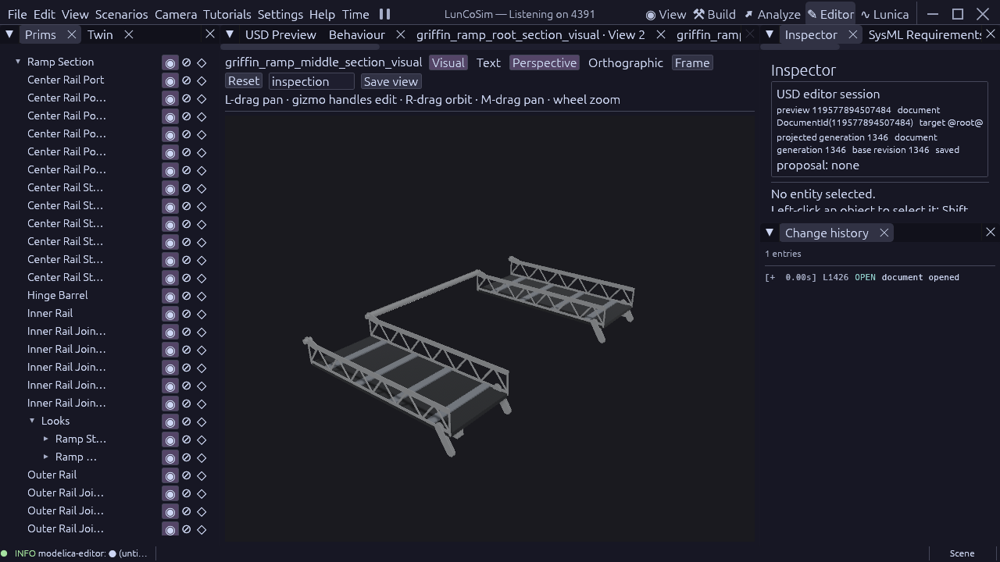
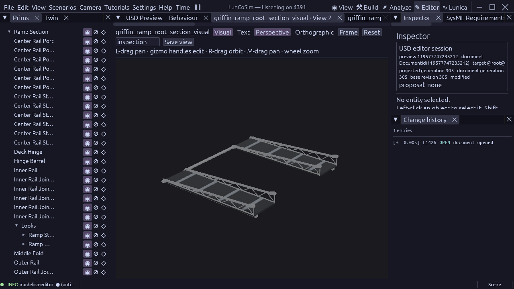

# Shorter middle section contract

Accessed 2026-10-23: [Astrobotic](https://www.astrobotic.com/lunar-delivery/landers/griffin-lander/)
confirms an aluminum frame, payload adapter, optional rover ramps and four legs.
The supplied cleanroom photograph establishes the inward folded silhouette and
open lattice appearance. Neither source provides a released ramp mechanism ICD.
The [native interference and unequal-fold study](griffin-ramp-interference-2026-10-22.md)
owns this reconstruction choice: middle length 1.449084054 m, root 2.149084054 m,
toe 1.799084054 m. The overall 5.397252162 m span is retained. Numerical geometry
is a study assumption, not supplier dimensional or structural qualification.

The middle component owns its local tracks, four level guide trusses, braces,
posts, treads, beams, shared silver/dark PBR finishes and named hinge frames.
SI metres, Y-up, +X from root fold to toe fold; entry frame (0, +0.20, 0) m,
exit frame (1.449084054, -0.12, 0) m. The root upper-chord datum supplies the
entry Y; the downward toe offset supplies room for the opposite toe sweep.
Track/stock dimensions and counts remain owned by GriffinRampRequirements.
The assembly owns bodies, masses, inertia, installation and joints.

This component is detached. Its lower exit datum now has explicit brackets: a compact entry tongue
and paired exit fork cheeks run between the native axes and the source rail
stock. An inboard heel web connects the cheeks to the guide; its position
leaves the selected fold direction open. Matching root forks use the same
source plate stock, 0.09 m attachment run and 0.03 m heel-web size. These
values derive from the existing 0.06 m lug width and remain reconstruction
choices. Detailed mating and sweep clearances require assembly qualification. No terrain/vehicle behavior
or performance is qualified by the isolated middle geometry.

The separate SysML package GriffinRampMiddleSectionRequirements defines
GMS-001 and Verify_GriffinRampMiddleSection. The production Rhai observer reads
typed source values, native cooked metric bounds and standard USD attributes.
It must reject a shortened instance despite unchanged local mesh coordinates.
The shared section builder regenerates the shorter members and full-height
trusses rather than stretching a root mesh. The root and middle gates share
observation mechanics, while their source identities and verification remain
separate. Component shape and datum checks precede the assembly clearance gate.

## Saved component checkpoint

The native Editor applied 757 base/truss operations to the middle, then added
and refined its connected fittings. Final saved middle document
119577894507484 is at generation 1346; root document 119577747235212 is at
305. These are session handles, not persistent asset identities. Both were
visually inspected after projection and text readiness. Each component owns
its actual geometry, with no added body, mass, solver state or dependency.

The shared component planner and observer remove duplicated root/middle
mechanics; separate packages, gate wrappers and source identities remain.
The formal span constraint also requires actual fitting envelopes, native
snapshot coherence, render-only collision roles and explicit structural PBR
bindings. Entry shaft and rail-local pins must share the source entry axis.
The middle's missing fitting geometry first made that observation unavailable;
a subsequent check caught unbound pin material. Those states cannot pass.
Fitting-envelope evidence is a component geometry check, not a strength or
manufacturing-fit analysis.

Normal production binary SHA256
`5b24ec52f8893910cf764334a75279a20522bfdd8d30d0bbfdb827b5ed28c73d`
at engine main/USD `0cb4d37137554af3227a316100c903f44a1c3a4c` passes both
119-check component gates. Each independent X-scale-0.8 fixture passes 118 and
fails the single physical-span/connected-geometry constraint as intended.
Four native USD preflights (both assets and positive fixtures) have zero
errors or warnings. SysML source revision `1657279327391262603` has zero
errors and 153 existing warnings, with no new component warnings. Typed
provenance covers 223 requirements, 223 evidence records and 72 sources.
[The pinned receipt](evidence/griffin-ramp-middle-section-2026-10-23.json)
contains source hashes, terminal results and native readback identities.

The main vehicle and original shared section are unchanged. The installed
middle-track/transition interference remains. The new toe component, opposite
toe sweep, complete installed-bank clearances, terrain fitting, landing/egress
and clean 60 FPS at 1280×720 High with real-time physics remain open. No FPS
measurement was taken for this checkpoint.
