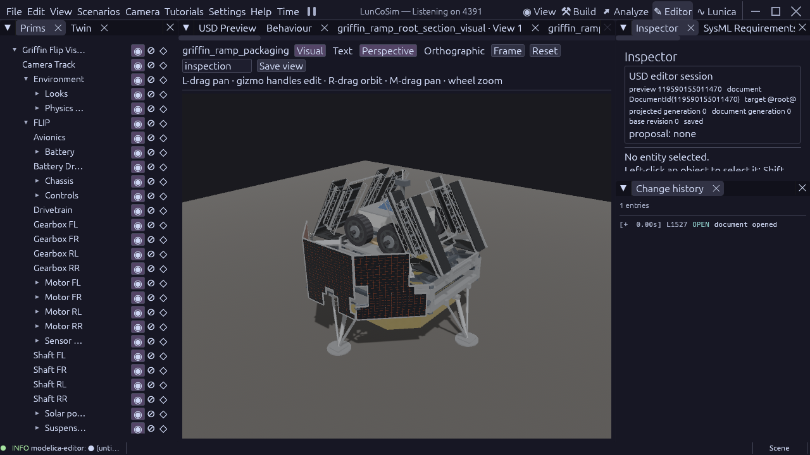

# Griffin ramp packaging and deployment study

This is a reconstruction geometry study. The new section assets are detached;
`vehicles/griffin_1.usda` still contains its old equal-length mechanism and
confirmed transition interference. No loaded or flight qualification is claimed.

The prior 120 mm lower toe-axis candidate fails payload packaging. Native f64
SAT finds overlaps between the straight interior stock of both inner toe guides
and FLIP's equipment box and payload deck, on both banks. The inscribed guide
cores exclude their rounded end caps and inset the faces; their maximum SAT
axis margin is approximately -0.025 m. The two FLIP targets are native Cubes
with only translation/scale in their own and ancestor frames. This establishes
a solid geometry intersection, not merely an overlap of loose AABBs. It is
not a runtime contact-penetration measurement.

The 32 coarse overlaps also include wheel/track and tread/wheel pairs. Those
conservative wheel boxes alone do not prove that the curved wheels intersect.
Both detailed source envelopes and exact-shape limits must remain explicit.

## Next reconstruction candidate

Retain the 2.149084054 m root and 1.449084054 m middle. The toe takes the
remainder of the existing 5.397252161 m span: 1.799084053 m. Raise the lower
fold axis from -0.12 to -0.08 m and rebuild its connected fittings. Extend
the fixed transitions outboard by 0.07 m, from 1.35 to 1.42 m long, retaining
their inboard edge. Their outer X edges become +/-2.42 m; root X targets are
+/-2.427114731507 m, preserving the existing half-thickness seam offset.
The bus and rover dimensions remain at their current source-owned estimates.

Move each folded root from its 120-degree inward transport pose to upright
first. Keep middle/toe flight latches until their respective phases. Unfold
the middle physically +180 to 0 degrees, then the toe physically -180 to 0,
then lower the extended roots to the existing nominal/terrain-fitted targets.
The toe uses the opposite child-frame offset to preserve its intended sweep.
The admitted native motor law, torque cap and normal substeps remain unchanged.

The read-only native study uses 106 poses with 5-degree sampling (and an
approximately nominal final root angle). Complete section envelopes separate
from all 44 measured FLIP parts at 104 poses. The two bank-specific stow
wheel-box candidates are further separated by individual section-member
bounds; their smallest SAT gap is 0.0897220 m. These figures are sampled
candidate geometry, not a continuous-clearance certificate. The smallest
unflagged coarse pose gap is 0.0305640 m and requires tighter observation for
a 0.05 m payload-clearance requirement. Complete installed geometry, reference
identity, both-bank/lander/ground checks and between-sample motion bounds are
still required.

Even with the 70 mm extension and 80 mm fold axis, the original middle-first
path fails: at a 165-degree middle fold, inscribed toe-guide cores intersect
both FLIP boxes on both sides. This is why the root-upright phase is a required
candidate change. Raising a torque cap or disabling contact cannot repair it.

A separate root/toe study compares the actual member envelopes at twelve
middle-fold angles for five offsets. At -0.08 m, the smallest sampled detailed
root/toe gap is about 0.040 m. This is stronger than treating each open ramp
as one filled box, but still needs continuous and full-path coverage. Current
entry-lug envelopes conservatively include the prior taller stock during this
read-only parameter study; shaft/pin positions follow the proposed axis.

## Sources and acceptance

[Astrobotic](https://www.astrobotic.com/lunar-delivery/landers/griffin-lander/),
accessed 2026-10-23, confirms the aluminum frame, optional rover ramps and
payload adapter. The supplied cleanroom photograph guides the inward folded
lattice silhouette. Neither source provides released ramp dimensions, mass,
hinge positions or a deployment ICD. The metric values, stand-off and phase
sequence above remain explicit study assumptions derived from interference
in this model, not supplier hardware data.

GriffinVehicleAssemblyRequirements::GriffinRampPackagingStudy owns the candidate
mounts and clearance settings. GVA-001 requires a complete native payload
clearance observation with an explicit between-sample motion bound; isolated
component passes and these diagnostic samples cannot satisfy it by themselves.
The existing GRR-017, landing and surface-operations gates retain loaded
mechanism acceptance. The full goal also retains realistic materials and
60 FPS at 1280×720 High quality with real-time physics.

## Saved two-bank study

`tests/griffin_ramp_packaging.usda` is now a saved static review fixture. It
references the three independent sections on each side, places the bearings
70 mm outboard, and supplies four visible, collision-enabled walking plates
from X=+/-1.0 to +/-2.42 m. These fixed plates have the same source track width,
thickness and shared walking-plate material as the ramps. The former invisible
full-width contact slabs, retired-bank joints/latches and obsolete bus ramp
sockets are inactive here. The inherited installed-bank scenario is inactive;
this fixture does not pretend to emit its old acceptance verdict.

The native f64 study covers 300 intervals from inward stow to upright, 180
middle intervals, 180 opposite-sense toe intervals and 119 intervals down to
the exact source nominal root angle. Both banks and all three sections produce
4,698 section/pose observations. Each section envelope is tested against all
44 measured FLIP parts. An uncertain envelope is refined against every actual
member, rather than treating the empty lattice as solid stock.

Each single-axis phase subtracts the largest native corner displacement to
the nearest sample over half an interval. A corner maximum bounds every point
inside that component envelope. The conservative certified payload gap is
**0.05031921791611015 m**, against the 0.05 m study requirement, with no failed
observations. This is a tight geometric margin, not a manufacturing tolerance
or an observed native contact separation.

After reopening the saved fixture, all 558 installed ramp members match their
measured source geometry attributes and native source-reference identities.
The six section placement residuals are at most 4.24e-16 m. The refreshed
fixture preserves the bank poses and FLIP geometry used by the path study.
Reopening matters after a component revision: an already composed preview can
retain older referenced stock despite a current standalone component tab.
The source/member comparison must pass before correlating the path result
with the saved assembly. The [receipt](evidence/griffin-ramp-toe-and-packaging-2026-10-23.json)
records this boundary and the full diagnostic hashes.

The read-only `griffin_ramp_packaging_checks` tool exposes `begin`, ordered
`add_section` capture, `assert_current`, `verify_installation` and `sample`.
It uses native bounds, vectors, quaternions and rigid-frame composition. Its
results retain explicit document/stage/source fences. Native reference source
identity is additionally inspected through the external `QueryUsdPrim`
topology result: querying the full lander topology inside one-shot Rhai exceeds
the current query-string limit. The tool therefore emits no full GVA-001
verdict, and GVA-001 is not mapped to an executable acceptance case yet.

Payload clearance does not accept ramp-to-ramp, lander, solar-panel, leg,
ground, mating or bridge sweep clearance. Joint frames, latches, unequal-section
mass properties and the root-upright mission phase still need promotion into
`vehicles/griffin_1.usda` and its loaded production gates. That vehicle retains
its earlier mechanism and known transition interference. No new landing,
egress or FPS acceptance is claimed by this static checkpoint.
