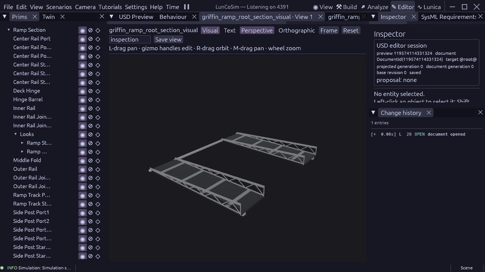

# Detached Griffin ramp root section

The longer root is saved as `components/lander/griffin_ramp_root_section_visual.usda`.
It has a source-owned length of **2.149084054 m**, two dark walking tracks,
four silver open truss guides, two underside beams and four treads per track.
The root guides rise toward their upper rail datum. Brace and tread stations
are rebuilt for this span; the component is not a stretched instance.

This is the first component of the [unequal-fold reconstruction study](griffin-ramp-interference-2026-10-22.md).
It is **not mounted** in `vehicles/griffin_1.usda`. That vehicle and its shared
equal-length section remain unchanged, including the confirmed middle-track /
fixed-transition interference. Component acceptance does not accept deployment.

## Sources and ownership

Astrobotic's [Griffin page](https://www.astrobotic.com/lunar-delivery/landers/griffin-lander/)
confirms a payload adapter and optional egress ramps. The supplied cleanroom
photograph guides the open trusses and inward-folded silhouette. Neither is a
released dimensional, hinge, mass or structural ICD. The length and fold
arrangement are reconstruction study choices, based on the native collider
inspection linked above. They must not be described as supplier dimensions.

`GriffinRampRootSectionRequirements::RampRootSection` owns the length, metric
limit, asset identity and typed datum names. Shared `GriffinRampRequirements`
continues to own track width, walking thickness, wheel stations, rail stock,
brace count and PBR material parameters. The existing visual builder accepts
a section length and regenerates stock stations. Complete assembly plans
still enforce the total-span contract. The vehicle owns bodies, mass, inertia,
installed transforms, joints and flight latches; this component adds none.
Standard Xforms mark the deck and middle-fold axes at (0, 0, 0) and
(2.149084054, 0.20, 0) m respectively.

The silver structural and dark walking PBR materials remain shared source-owned
finishes. They are appearance proxies, not identified flight coatings. The
native document tools authored, saved and reopened the component and fixtures.
The saved component was inspected visually in the Editor at 1280×720:

## Verification boundary

The registered `Verify_GriffinRampRootSection` production gate checks 119 facts:
native cooked metric envelopes, track topology and collision roles, guide,
brace, beam, post and tread stations, and both named datum frames. Its negative
fixture applies X scale 0.8 while preserving correct local mesh coordinates;
118 checks pass and the physical-span constraint fails. That fixture is kept
outside the normal verification registry.

Both component and positive fixture pass native USD preflight with zero
errors. Typed source provenance covers 222 requirements, 222 evidence records
and 71 sources. SysML has zero errors and 153 existing warnings; the new root
package adds none. The existing installed ramp source gate passes 1,257 checks
and flight stow passes 272. GRR-006 now measures all three cooked dimensions
in their native rigid cooking frame, plus local placement and exact unit scale /
transform-order checks. Its original 0.002 m limit is retained. It previously
compared rotated stage AABBs with local dimensions, which is invalid.

The engine query extension is commit `ab8b518ec`; local combined main/USD is
`0cb4d37137554af3227a316100c903f44a1c3a4c`. Hull and mesh vertices remain in
canonical stage metres and expose their existing f64 rigid `local_to_stage`
pose. This is observation metadata; it changes no physics state. The separate
21-check production query gate covers translated and rotated hull inversion,
plus its existing malformed-collider diagnostic. The adjacent JSON receipt
pins sources, binary cohorts and terminal results.

Middle and toe components, connected hinge stock, the opposite toe sweep,
both complete installed banks, continuous path clearance, panel/leg/FLIP
clearance, terrain fitting and loaded deployment remain open. The current
vehicle remains unsuitable for accepted ramp deployment. This checkpoint
contains no clean FPS measurement and does not close 60 FPS at 1280×720,
High quality and real-time physics. Native physics defects remain assigned
to the optimization worktree.
