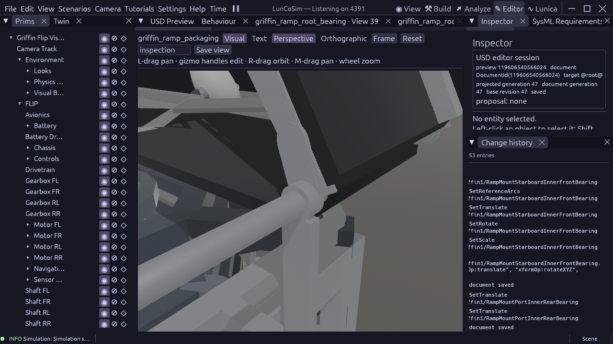

# Griffin root bearing reconstruction

The saved raised-root fixture's four rectangular pedestal tops contain their
coaxial pins. This render-only proxy has no bore and cannot qualify a bearing
fit. Replace each top with a reusable annular housing and end its supporting
stem halfway through the housing's lower wall. Place both on the inboard side
of the rotating tongue, outside the walking track; a centred housing would
contain the tongue and its stem would cross the lowered walking entrance. Retain the existing deck shoe,
root axis, pin radius, axial stock, bus support and structural appearance.

The source owns a 0.5 mm radial bore allowance and a 0.4 mm minimum measured
facet-to-pin clearance. These are reconstruction assumptions. A 48-segment
native revolved profile gives a conservative polygonal aperture; the observer
measures its inner-wall facets rather than treating the ring's filled bounds
as its solid. The housing belongs to the bus and adds no independent rigid
body, collider or guessed mass. Grade, lubricant, bearing stiffness and load
capacity remain unqualified.

This is geometry/mating work, separate from solver repair and loaded egress.
It does not change the walking tracks, nominal seam, bank axis or rover size.

The bearing length derives from half the source pin length after subtracting
the tongue and two axial allowances: 24.5 mm. Its centre is 17.75 mm inboard
of the tongue plane, giving a 0.5 mm axial running gap. The root's central
shaft uses the same 20 mm radius as its existing pins so it passes through
the bore; retaining the former 25 mm shaft would obstruct the new housing.
These fit choices remain reconstruction assumptions, with no load rating.

## Qualification

All four stations are installed in the saved packaging fixture. Each has an
inboard housing, a narrower stem meeting the lower housing wall, and the
existing deck shoe. The shaft now matches its 20 mm pin radius. No rigid body,
collider or guessed mass was added. The bus, rover, walking tracks, bank axes
and deployment phases retain their previous dimensions and placements.

The production housing gate passes 6 checks. The revised root passes 128.
Their shortened-instance negative fixtures each fail exactly one required
constraint, with no observation error. The housing's 48 measured inner-wall
facets retain at least 0.456108 mm from the coaxial source pin. Maximum
component dimension residual is below 2 nanometres; this describes numerical
geometry agreement, not a fabrication tolerance.

The read-only mating certificate compares all 97 root members against each
housing and its stem: **776 comparisons** across four stations. It uses the
invariance of axial intervals and radial distances under root-axis rotation,
so it covers any root angle rather than only sampled poses. Coaxial cylinders
use their measured native analytic radius; other members use conservative
native stock bounds. The qualified source bore, identical installed mesh and
rigid frames are prerequisites. After the source 2 micrometre geometry margin,
the minimum certified separation is 0.398 mm. This bound is conservative; it
is not a new flight fit specification. A deliberate 1 mm housing offset is
rejected, then undone through the native journal. All four stations pass again
at final document generation 47. Each new housing also retains at least
1.29834 m from the measured FLIP payload envelopes.

The housing, root, positive and negative fixtures, packaging assembly and
observer script each pass asset preflight with zero errors and warnings.
Mounted SysML validation has zero errors and 153 existing warnings. The
[receipt](evidence/griffin-root-bearing-2026-10-23.json) pins the production
verdicts, source hashes, conditional mating evidence and exact coverage.
The [overview](evidence/griffin-root-bearing-2026-10-23-overview.png) records
the unchanged inward-stow silhouette.

## Runtime and remaining scope

An assembled-fixture runtime attempt reaches an Avian island panic before an
authored verdict: neither body 1274v0 nor 1275v0 is in an island. The two body
identities are not yet mapped to USD paths. This is a static review asset with
rigid bodies disabled; no loaded acceptance is inferred. The exact command,
binary/source identity and panic tail are recorded in optimization's existing
`docs/reviews/griffin-physics-handoff-2026-10-22.md`. The normal binary used here
predates the current engine checkout. No solver, dependency or physics setting
was changed by this task.

The new asset initially exposed a stale warm reference; Twin reindex and a
canonical document reopen resolved it before geometry qualification. The
mounted preflight was repeated in a separate owned session with the canonical
Twin authority, avoiding a retired-authority validation ticket. That session
has exited. These are cold/readback qualifications, not warm-refresh claims.

The production vehicle still has the earlier ramp mechanism. Complete
middle/toe, other-structure, antenna, ground and mating acceptance, dynamic
mass/joint/latch/phase integration, loaded traversal and clean 60 FPS remain
open. The earlier payload/bridge sweep belongs to its pinned receipt; only the
root shaft radius decreased here, and the new fixed housing interfaces have
the separate coverage stated above.
