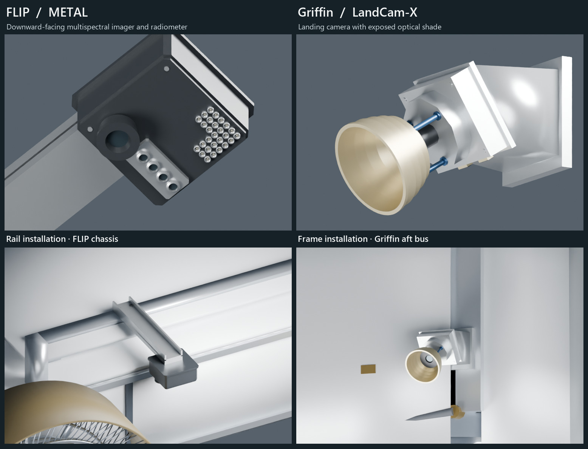

# FLIP and Griffin science cameras

Reviewed 25 November 2026 on the production `griffin_1_surface_ops.usda` scene. The upper images show the optical faces. The lower images show how the instruments attach to the vehicles. The review uses neutral studio lighting.

## FLIP · METAL

Hoza et al. show the delivered instrument in Figure 1 and its intended downward orientation on a FLIP payload rail in Figure 2. The hardware photograph resolves a dark enclosure, a projecting camera barrel, a four-aperture thermal radiometer and a separate bank of illuminators. The paper identifies seven illumination colours spanning 350–940 nm. The emitter grouping and mechanical envelope in the model are visual estimates. Astrolab lists the instrument on its Mission 1 manifest. [Interlune and NASA Ames, LPSC 2026, paper 1370](https://www.hou.usra.edu/meetings/lpsc2026/pdf/1370.pdf) · [Astrolab payload manifest](https://www.astrolab.space/mission-1/)

The CAD rover carries `METAL` on `CADVisuals/PayloadRail1`. The channel rests on the rail's upper face and carries the optical head beyond the chassis. The selected rail station, bracket and fasteners fit this reconstruction. `METALContextCamera` points along the imager axis with a 50° square study field. Its RGB view helps inspect the ground beside the wheel. Spectral imaging, illumination sequences and brightness-temperature measurements would require separate instrument models.

## Griffin · LandCam-X

ESA's integration photographs show the machined housing, blue standoffs, stepped metallic shade and a temporary lens cover. The model uses the exposed shade and lens for the flight configuration. OIP gives an approximate 11 × 10 × 14 cm envelope and a nominal 70° square field with a circular field boundary for the parent PILOT optical unit. The modeled head measures 11.0 × 10.6 × 14.0 cm in its own axes, excluding the lander adapter. The viewport uses the square angular extent. Its RGB response and rectangular image omit the detector's monochrome response, distortion and circular mask. [ESA installation photographs](https://www.esa.int/articles/about-us/directorates/human-and-robotic-exploration/moon/lunar-science-tech-demos/landcam-x) · [OIP optical unit](https://oipspace.be/solutions/cameras/navigation/pilot/)

The camera shoe seats on the bus frame beside the aft blanket. Its adapter points the camera 32° below horizontal in the vehicle frame. The exact bus station, adapter depth and angle are study choices. ESA describes the flight payload as collecting imagery for later trajectory reconstruction. The study camera has no guidance connection.

## Acceptance

| Check | Result |
| --- | --- |
| FLIP instrument identity and pose | Pass. The saved scene resolves one METAL head on the fixed payload rail. The four radiometer windows and illumination bank are visible in the underside review. The camera axis is vertical downward in the rover frame. |
| FLIP array clearance | Pass at the sampled poses. Across 21 evenly spaced hinge angles from −90° to 0°, the smallest separation between the axis-aligned bounds of a payload part and a moving array part was 87 mm. Mesh bounds used transformed vertices. |
| Griffin instrument identity and pose | Pass. The saved scene resolves the optical head on the bus frame. The installed view shows the uncapped shade clear of the adjacent blanket. The measured boresight points down and toward the aft side. |
| Sightlines and optics | Pass for the center rays. Neither camera's center ray intersected extracted vehicle surfaces in its local mount neighborhood over a 3 m cast. The saved USD aperture and focal-length pairs give 50° and 70° fields respectively. |
| Flight calibration | Open. Public sources support instrument identity, visible features and pointing roles. Exact flight transforms, radiometry and sensor performance require calibration and integration data. |

LunCoSim `0.6.0-dev (22d898aa)` reopened the default scene and resolved both mounted cameras. OpenUSD 26.08 supplied the independent geometry checks, and Blender 5.1.2 rendered the saved components and their mounting neighborhoods. These checks cover static composition and sampled geometry. Full mission dynamics were outside this verification.

| Reviewed component | Git blob |
| --- | --- |
| [METAL](../components/rover/flip_metal_imager.usda) | `e6cd81b14fd915ed0da516deccd53d664a9a520b` |
| [LandCam-X](../components/lander/griffin_landcam_x.usda) | `72c2baac61384d8a780a177b64bb9b86d32e6455` |
